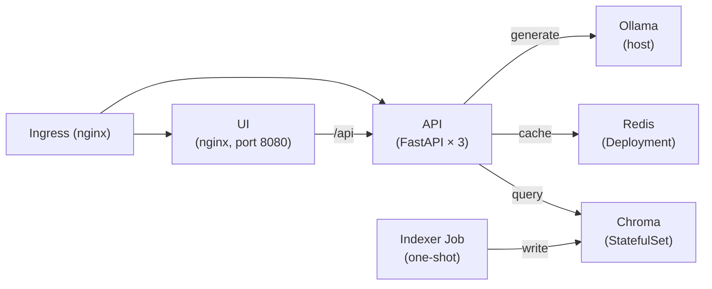

# RAHBAR

[](https://github.com/Anfey-SE/rahbar/actions/workflows/ci.yml)

RAHBAR is a grounded Retrieval-Augmented Generation (RAG) service for FAST-NUCES students. It answers questions about university policies, academic rules, and fee structures using a verified corpus of official documents — and explicitly declines to answer when the corpus does not contain the information.

## Architecture



## Quick Start (from a clean clone)

```bash
# 1. Start minikube
minikube start --driver=docker

# 2. Enable ingress
minikube addons enable ingress

# 3. Build and load images
make images

# 4. Apply manifests (dev overlay)
kubectl apply -k k8s/overlays/dev

# 5. Run the dummy indexer (week 1 / CI)
kubectl wait --for=condition=complete job/indexer -n rahbar --timeout=120s

# 6. Add local DNS entry
echo "$(minikube ip) rahbar.local" | sudo tee -a /etc/hosts

# 7. Ask a question
make ask Q="What is the minimum attendance to sit the final exam?"
```

## Apply Order

```bash
kubectl apply -k k8s/overlays/dev        # namespace, configmap, services, deployments, ingress, hpa
kubectl rollout status deployment/api -n rahbar
```

## API Endpoints

| Method | Path | Purpose |
|--------|------|---------|
| GET | `/healthz` | Liveness — returns `{"status":"alive"}` instantly |
| GET | `/readyz` | Readiness — checks Chroma, Redis, embed-model pin |
| GET | `/metrics` | Prometheus metrics (request count, latency) |
| POST | `/api/ask` | Answer a question from the corpus |

### Example request

```bash
curl -s http://rahbar.local/api/ask \
  -H "Content-Type: application/json" \
  -d '{"question": "What CGPA is needed to avoid academic warning?"}' | jq .
```

```json
{
  "request_id": "b66f4d64-...",
  "answer": "A student must maintain a CGPA of at least 2.00 to avoid academic warning.",
  "citations": [{"source": "academic-rules-handbook-jun-2026.pdf", "section": "5.4", "page": 12}],
  "answered_from_context": true,
  "confidence": "high",
  "retrieved": [...],
  "provider": "ollama"
}
```

## Running the Indexer

```bash
# Dummy index (no model needed — for dev/CI)
kubectl create job reindex-$(date +%s) --from=cronjob/reindex -n rahbar

# Or directly in WSL
wsl -d Ubuntu-22.04 -e bash -lc "cd /mnt/c/Users/DELL/rahbar && python -m pipeline.run --dummy"
```

The indexer is a one-shot Kubernetes Job (`k8s/base/indexer-job.yaml`). A weekly CronJob (`reindex`) re-indexes automatically.

## Cluster Start Instructions

```bash
# minikube (Windows/WSL)
minikube start --driver=docker --memory=4096
minikube addons enable ingress
minikube tunnel   # in a separate terminal (for Ingress on port 80)
```

## Configuration

All settings come from the ConfigMap `rahbar-config` in namespace `rahbar`. Key variables:

| Variable | Default | Purpose |
|----------|---------|---------|
| `EMBED_MODEL` | `dummy-768` | Must match what the indexer used |
| `RETRIEVER` | `stub` | `stub` or `chroma` |
| `LLM_PROVIDER` | `stub` | `stub`, `ollama-host`, or `hosted` |
| `CHROMA_HOST` | `chroma` | Chroma service name |
| `REDIS_HOST` | `redis` | Redis service name |

## Team

- **Member 1** — Platform & DevOps (Dockerfiles, Kubernetes, CI/CD, /readyz, embedding pin)
- **Member 2** — RAG pipeline (retriever, providers, eval, corpus)
